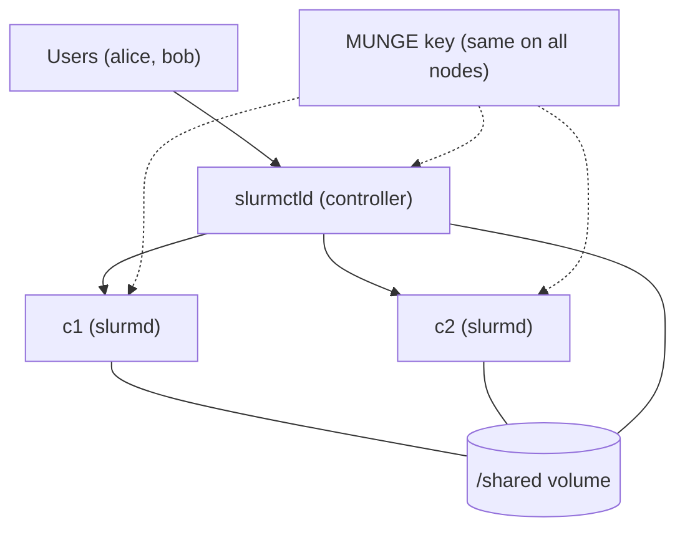

# HPC Cluster with Slurm (containerized lab)

A small Slurm cluster (1 controller + 2 compute nodes) that runs on a single machine with Docker Compose.
Built as a hands-on project for **Linux administration, networking and workload scheduling**, and as the base
layer for a GPU monitoring and benchmarking portfolio.

> **Scope, stated honestly:** this is a *simulated* multi-node cluster. All "nodes" are containers on one host,
> so it demonstrates Slurm configuration and scheduling behaviour, not real multi-machine networking or
> multi-node GPU hardware.

## Architecture



| Component | Role |
|---|---|
| `slurmctld` | Controller: accepts jobs, schedules them, keeps cluster state |
| `c1`, `c2` | Compute nodes running `slurmd` (2 CPUs / 1 GB each in config) |
| MUNGE | Authentication between all Slurm daemons |
| `/shared` volume | Stand-in for NFS: job output visible from every node |
| `alice`, `bob` | Sample users with identical UIDs on every node |

## Quick start

Requirements: Docker with the Compose plugin (Docker Desktop with WSL2 works).

```bash
make up          # build the image and start the cluster
make status      # sinfo: both nodes should be "idle"
make test        # runs a 2-node job as user alice
make queue       # submits 8 jobs to a 4-core cluster, shows the queue
make shell       # shell as alice inside the controller
make clean       # stop and delete everything, including the volume
```

If a node shows `inval` or `drain`, your Docker host has fewer resources than `configs/slurm.conf` claims.
Run `docker compose exec c1 slurmd -C` and adjust the `NodeName=` line.

## Repository layout

```
.
├── docker-compose.yml     # controller + 2 compute nodes
├── docker/                # Dockerfile and entrypoint (MUNGE + slurmctld/slurmd)
├── configs/slurm.conf     # cluster, node and partition definition
├── jobs/                  # sample batch scripts
├── scripts/smoke_test.sh  # end-to-end check
├── docs/troubleshooting.md
└── results/               # screenshots and measurements (fill in as you go)
```

## Roadmap

- [x] **Phase 1:** controller + 2 compute nodes, MUNGE auth, CPU partition, sample jobs
- [ ] **Phase 2:** GPU node: `Gres=gpu:1` with the real GPU, `gpu` partition, `--gres=gpu:1` jobs
- [ ] **Phase 3:** accounting (`slurmdbd` + MariaDB), per-user limits, fair-share
- [ ] **Phase 4:** Prometheus + Grafana dashboard for queue state and node utilization
- [ ] **Phase 5 (optional):** same cluster on 2 to 3 real VMs with NFS, for true multi-host networking

## Results

_Fill this section with real measurements and screenshots as you complete each phase. Do not add numbers you have not measured._

## Problems and fixes

See [docs/troubleshooting.md](docs/troubleshooting.md). Keep this updated while building; it is the most
valuable part of the repository for a reader.

## Security note

The MUNGE key is generated at image build time for lab use only and is not stored in the repository.
